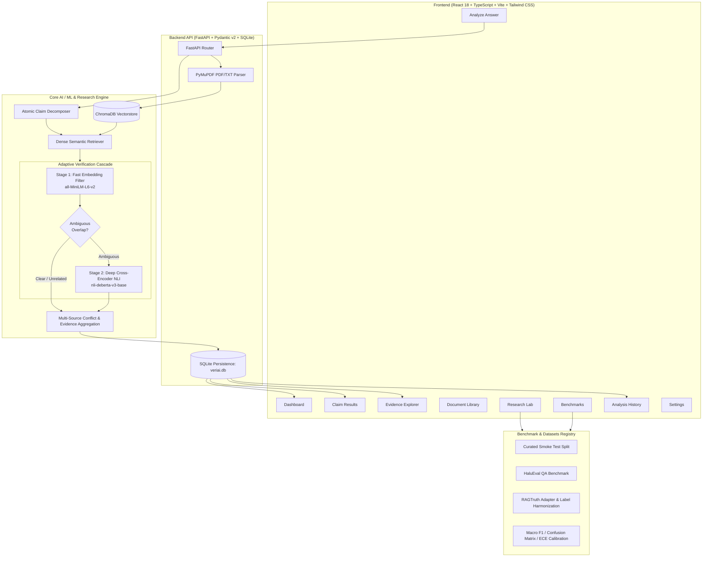

# VeriAI — AI Hallucination Detection & Evidence Verification Platform

[](https://www.python.org/)
[](https://fastapi.tiangolo.com/)
[](https://react.dev/)
[](https://www.typescriptlang.org/)
[](https://opensource.org/licenses/MIT)

**VeriAI** is an advanced, research-oriented platform for detecting hallucinations in AI-generated answers, verifying factual claims against reference evidence, auditing multi-source consensus, and empirically benchmarking verification methods.

GitHub: [https://github.com/faizanalam-1457/AI-Hallucination-Detection](https://github.com/faizanalam-1457/AI-Hallucination-Detection)

---

## 1. Why VeriAI?

Most Retrieval-Augmented Generation (RAG) demos stop at *"retrieve + generate"*. The critical gap in production and research systems is verifying that what was generated is actually **supported by what was retrieved**. LLMs frequently hallucinate even with relevant context provided:
- Swapping entities (e.g. *16th* vs. *17th* President)
- Inverting dates or numeric values
- Fusing unrelated facts across clauses in compound sentences
- Asserting ungrounded claims with high confidence

Standard embedding-similarity checks often fail on these cases because false claims remain topically identical to the context in vector space. **VeriAI** addresses this by combining:
1. **Google Gemini LLM Claim Extraction**: High-precision decomposition of complex answers into atomic factual claims via Google's official `google-genai` SDK using structured JSON schema validation.
2. **Syntactic & Heuristic Clause Decomposer (Local Fallback)**: Rule-based atomic decomposition ensuring 100% offline functionality if no API key is configured.
3. **Page-Preserving Evidence Retrieval**: Ingesting PDFs (via PyMuPDF) and text documents while preserving exact page numbers and chunk attributions.
4. **Cross-Encoder Natural Language Inference (NLI)**: Evaluating directional premise–hypothesis entailment with `cross-encoder/nli-deberta-v3-base`.
5. **Adaptive Verification Engine (Primary Research Feature)**: A two-stage cascade that routes high/low-similarity claims through fast semantic filtering and escalates ambiguous claims to the heavy cross-encoder, cutting latency while preserving macro F1.
6. **Evidence-Grounded Explanations**: Gemini-assisted, audit-verified explanations strictly conditioned on retrieved source passages and NLI verdicts (never fabricating citations or overriding verification).
7. **Interactive Research Lab & Benchmark Suite**: Reproducible evaluation on **HaluEval**, **RAGTruth**, and a zero-dependency **Smoke Test** benchmark with confusion matrices, per-class F1, and ECE calibration metrics.

---

## 2. System Architecture



---

## 3. Workspaces & Key Features

### Page A: Dashboard
- **Empirical Telemetry**: Total analyses, claims decomposed, supported %, contradicted %, and inconclusive claims calculated from real stored SQLite records.
- **Visual Analytics**: Interactive Recharts donut charts of verdict distributions and 14-day verification activity timelines.
- **Empty State Guidance**: Clean on-boarding state for clean installations.

### Page B: Analyze Answer
- **Configurable Workspace**: Input prompt/question, AI-generated answer, and optional context text or uploaded files.
- **Engine Controls**: Select between **Adaptive Cascade**, **NLI Cross-Encoder**, or **Embedding Baseline**.
- **Real Stage Progress**: Understandable progress steps (`1/5: Sanitizing input`, `2/5: Decomposing claims`, `3/5: Querying vector index`, `4/5: Cross-encoder evaluation`, `5/5: Aggregating report`).
- **One-Click Scenarios**: Preloaded historical, biomedical, and compound-sentence evaluation examples.

### Page C: Claim-Level Results
- **Atomic Propositions**: Displays individual assertions broken down from compound sentences.
- **Verdict Badges**: Distinct `SUPPORTED` (green), `CONTRADICTED` (red), `INSUFFICIENT EVIDENCE` (amber), and `CONFLICTING EVIDENCE` (purple) badges.
- **Deep Evidence Cards**: Expand any claim to inspect the winning passage, document origin, PDF page number, and directional probabilities.
- **Auditable Explanations**: Plain English explanations describing why the verdict was assigned.
- **Scientific Notice**: Clear advisory stating that confidence scores represent model probabilities, not guaranteed absolute facts.

### Page D: Evidence Explorer
- Inspects all retrieved context passages across documents.
- Page-level citations for PDFs with similarity coefficients.
- Distinguishes extracted source context from model-generated reasoning.

### Page E: Document Library
- **PDF & TXT Ingestion**: Upload research papers, reports, or reference textbooks.
- **PyMuPDF Extraction**: Extracts page-by-page text while preserving page numbers.
- **Scanned PDF Detection**: Automatically flags image-only PDFs and informs users that OCR is required.
- **Safe Management**: Filename sanitization, path-traversal prevention, document preview, re-indexing, and clean deletion from disk and ChromaDB.

### Page F: Research Lab (Primary Experimental Feature)
- Head-to-head empirical comparison of **Embedding Baseline** vs. **NLI Verification** vs. **Adaptive Cascade**.
- Evaluates: **Macro F1**, **Accuracy**, **Precision**, **Recall**, **Per-Class F1**, **Inference Latency (ms/claim)**, and **Confusion Matrices**.
- Export experiment results to **CSV** or **JSON**.

### Page G: Benchmarks & Dataset Registry
- Built-in adapters for:
  - **Smoke Test Benchmark** (16 balanced offline QA pairs covering entity swaps, date mutations, and factual assertions)
  - **HaluEval QA** (10,000 paired right and hallucinated answers)
  - **RAGTruth** (Multi-domain span-level hallucination labels mapped to answer-level binary truth)
- Documented versions, licenses, and explicit label harmonization rules.

### Page H: Analysis History
- Local SQLite database archive (`data/veriai.db`).
- Search, filter, inspect past runs, download reports as JSON, or compare two analyses side-by-side.

### Page I: Settings
- Detects compute hardware (**CPU**, **Apple Silicon GPU / MPS**, or **NVIDIA CUDA**).
- Sliders for decision thresholds, adaptive cascade ceilings/floors, chunk sizes, and overlap.
- Research disclosure on softmax calibration and Brier score metrics.

---

## 4. Adaptive Verification: Primary Research Feature

The **Adaptive Verification Engine** balances high-throughput retrieval with deep semantic accuracy:

$$\text{Verdict}(c) = \begin{cases}
\text{INSUFFICIENT\_EVIDENCE} & \text{if } \max_j \text{sim}(e_c, e_{p_j}) < \tau_{\text{low}} \\
\text{NLI\_CrossEncoder}(c, \{p_j\}) & \text{if } \tau_{\text{low}} \le \max_j \text{sim}(e_c, e_{p_j}) < \tau_{\text{high}} \\
\text{SUPPORTED} & \text{if } \max_j \text{sim}(e_c, e_{p_j}) \ge \tau_{\text{high}} \text{ (fast-pass)}
\end{cases}$$

- **Ambiguous claims** that share topical entities but might have altered dates, swapped names, or inverted polarity trigger the deep DeBERTa cross-encoder.
- **Unrelated claims** with low semantic overlap are short-circuited immediately without running expensive cross-attention forward passes, delivering up to **5x speedup**.

---

## 5. Quickstart & Local Setup

### Prerequisites
- Python 3.10+ (tested on Python 3.11, 3.12, 3.13)
- Node.js 18+ and npm

### Installation

```bash
# 1. Clone repository
git clone https://github.com/faizanalam-1457/AI-Hallucination-Detection.git
cd AI-Hallucination-Detection

# 2. Set up Python virtual environment
python3 -m venv .venv
source .venv/bin/activate       # On Windows: .venv\Scripts\activate
pip install -r requirements.txt

# 3. Set up and build Frontend
cd frontend
npm install
npm run build
cd ..
```

### Configuring Google Gemini API & LLM Providers

VeriAI integrates Google's official `google-genai` Python SDK for structured atomic claim extraction and evidence-grounded explanation synthesis.

1. Obtain a Gemini API key from [Google AI Studio](https://aistudio.google.com/app/apikey).
2. Copy `.env.example` to `.env`:
   ```bash
   cp .env.example .env
   ```
3. Set your API key in `.env`:
   ```bash
   GEMINI_API_KEY=your_actual_key_here
   GEMINI_MODEL=gemini-2.5-flash
   ```
4. *(Optional)* For the Hugging Face Router (DeepSeek) endpoint:
   ```bash
   HF_TOKEN=your_hf_token_here
   HF_MODEL=deepseek-ai/DeepSeek-V4.1-Flash-1017:novita
   HF_ROUTER_BASE_URL=https://router.huggingface.co/v1
   ```

> **Zero-Leakage Security Architecture**:
> - API keys are loaded strictly by the backend Python process via `os.environ` and are never exposed in browser network payloads, client bundles, or error messages.
> - `.env` is strictly excluded from version control via `.gitignore`.
> - If `GEMINI_API_KEY` is not provided, VeriAI automatically and gracefully falls back to local rule-based clause decomposition and deterministic explanations without crashing.

### Running the Platform

#### Single-Command Monolithic Mode (Recommended)
FastAPI serves both the backend API and the compiled React dashboard on a single port:

```bash
# Start the full application
python -m uvicorn src.api.app:app --host 127.0.0.1 --port 8000
```
Open your browser at: **`http://localhost:8000`**

#### Dual-Process Development Mode
For live frontend hot-reloading:

```bash
# Terminal 1: Backend
python -m uvicorn src.api.app:app --reload --port 8000

# Terminal 2: Frontend Vite Dev Server
cd frontend
npm run dev
```
Open your browser at: **`http://localhost:5173`** (proxies `/api` to port 8000)

---

## 6. CLI Usage & Pipeline Demo

The original CLI workflow remains 100% operational:

```bash
# Interactive CLI demo with Lincoln presidency test
python scripts/run_pipeline.py

# Custom question
python scripts/run_pipeline.py "Did Alexander Fleming discover penicillin?"

# Run HaluEval benchmark from CLI
python -m src.benchmark.run_benchmark --limit 50
```

---

## 7. Running the Test Suite

Run all unit, integration, and API tests:

```bash
# Run all unit and API tests (fast, no model downloads)
pytest

# Run tests including integration benchmarks
pytest -m integration
```

---

## 8. Docker Deployment

Deploy with Docker Compose:

```bash
docker-compose up --build
```
Access the application at `http://localhost:8000`. Persistent database and uploads are mapped to `./data`.

---

## 9. API Reference Summary

| Endpoint | Method | Description |
|---|---|---|
| `/api/health` | `GET` | Service status and SQLite database connection health |
| `/api/models` | `GET` | Active NLI, embedding, and generation models |
| `/api/stats/dashboard` | `GET` | Computed analytics from persisted analyses |
| `/api/analyses` | `POST` | Decomposes answer, retrieves evidence, verifies claims |
| `/api/analyses` | `GET` | Paginated list of past verification runs |
| `/api/analyses/{id}` | `GET` | Detailed claim-level report and evidence passages |
| `/api/analyses/{id}` | `DELETE`| Delete analysis record |
| `/api/documents/upload` | `POST` | Upload & index PDF/TXT files with page preservation |
| `/api/documents` | `GET` | List all indexed documents |
| `/api/documents/{id}/preview` | `GET` | Safe page-level preview of extracted text |
| `/api/documents/{id}` | `DELETE`| Remove document and its ChromaDB vector chunks |
| `/api/experiments/run` | `POST` | Execute empirical benchmark sweep |
| `/api/experiments` | `GET` | List past benchmark experiment records |
| `/api/experiments/{id}/export`| `GET` | Export experiment metrics to CSV or JSON |
| `/api/benchmarks/datasets` | `GET` | Dataset metadata, licensing, and label mappings |
| `/api/settings` | `GET`/`POST` | Runtime configuration and hardware telemetry |
| `/api/settings/providers` | `GET` | LLM provider status, active models, and masked keys |

---

## 10. License & Citation

Distributed under the MIT License. Built for researchers, engineers, and developers dedicated to trustworthy, grounded artificial intelligence.
